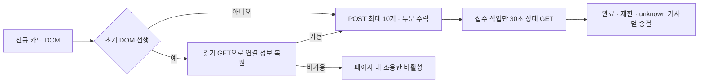

# 신규 기사 요약 UI 구현·검증 기록

- 기준일: 2026-11-25
- 앱 비교 기준 커밋: 5ba546c6626a9ace8bfcb8cbaa3c72e42420046a
- 운영 고정 커밋: ad0f7d94262a116652b7bb2f283781d9eeb1d60e
- 운영 SCRIPT SHA256: 734c5317ec438f2e405284175a79a5aa92c8d00d2cce4670cfa4698f4ab48e1f
- 앱 모듈 SHA256(LF 정규화): 91bb8f3896bbf50b26205aca1de76a07ddeab44623bd9277cb28089e838a1a69

coordinator가 승인한 앱 범위만 구현한다. 발행기 SCRIPT·생성 HTML·운영 배포는 TSM 소유이며 이 작업에서 수정하지 않았다.



- [x] 경계 테스트 실패를 먼저 재현하고 앱 모듈을 구현한다.
- [x] 확정 v1.3 API·DOM 계약과 실제 운영 코드의 응답을 대조한다.
- [x] 실제 SCRIPT/CSS를 AST 상수 추출로 그대로 삽입한 모의 화면에서 두 상태 모듈의 공존을 검증한다.
- [x] 전체 테스트·문법 검사·PR을 준비한다.
- [ ] 최신 SHA의 독립 재검토 후 TSM이 병합·배포한다.

계약과 동작:

- DOM은 `.fresh .item[data-candidate-id]`, 선택 `data-summary-status`·`data-summary-requested`를 사용한다. requested 문자열 false는 신규 POST, true는 기존 결과 GET, 누락은 v0 호환, 잘못된 값은 해당 카드만 제외한다.
- 렌더 완료 이벤트는 `briefing:fresh-rendered`, detail은 `{updated,summary_available,ip_budget}`다. summary_available의 boolean false만 document 단위 비활성 latch로 처리하며 이후 true나 재초기화로 복구하지 않는다(페이지 재열기 필요).
- 모듈보다 DOM·이벤트가 먼저 도착했으면 공개 `GET /api/briefing` 1회로 availability/IP 예산만 복원한다. 응답 후보는 POST 대상에 추가하지 않고 현재 DOM ID만 사용한다. 실패·destroy·숨김·늦은 false/true 경합을 검증했다. 정상 리스너 선행 경로의 추가 GET은 0회다.
- POST 최대 10개는 서버가 항목별 부분 수락한다. 기존 작업 반환은 IP 예산을 소비하지 않으므로 클라이언트의 잔여 숫자로 배열을 미리 자르지 않는다. 전역 예산 30과 접속별 IP 예산은 분리 표시하며 IP limit·remaining은 서버 값을 검증해 사용한다.
- queued/running/waiting_limit와 상세 결과가 필요한 기존 작업은 GET 대상이다. ip_limited는 미접수·당일 종결하고 다음 KST 상호작용에 해제한다. 다른 사람이 접수해 새 DOM이 requested=true가 되면 POST 없이 기존 결과를 조회한다.
- unknown·처음 보는 문자열 status는 해당 기사만 종결한다. 403은 해당 document의 신규 POST만 막고 기존 작업 GET은 유지한다. 404/405/501·HTML 응답은 요약 연결을 조용히 비활성화한다. 429는 분당 요청 제한으로 안내하며 IP 일일 소진과 구분한다.
- GET 연속 오류는 30→60→120→240→300초 백오프, 긴 Retry-After는 원 deadline을 보존하는 최대 1시간 chunk로 대기한다. 과거 날짜·0초도 최소 30초를 기다린다. 정상 복구 시 오류 안내를 지운다.
- ISO 소수초 1~9자리와 달력을 검증하고 GET의 생략 선택 필드 3개를 초기화한다. textContent만 사용하며 중복 링크는 검증한 내부 발행 경로만 허용한다. 새 POST 실패가 이전 ip_limited/unknown 종결을 초기화하지 않는다.

실행 결과:

| 검사 | 결과 |
|---|---|
| 전체 Node 테스트 | 94개 성공·0개 실패(신규 요약 모듈 60개) |
| JS 문법 검사 | 종료코드 0 |
| 실제 운영 DO의 메모리 검사 | 5 queued/5 ip_limited, 재클릭 IP 사용량 5 유지, 타 IP 기존 작업 재사용 0, 개별 unknown, 다음 KST 일자 5 수락 |
| 실제 SCRIPT·부분 수락 화면 | 10개 카드 → 5개 완료/5개 IP 제한, 10회 재클릭·DOM 교체 후 POST 1회, 상태 GET은 접수 ID 5개만 |
| 기존 결과·이벤트 선행 | 4개 카드/고유 ID 3개, 기존 done은 GET, 신규 ID 2개만 POST 1회, 최종 완료 카드 4개 |
| 선행 false → true | 모듈 초기 연결 복원 GET 1회, POST 0회·상태 GET 0회·원문 카드 4개 보존 |
| 구 API | 원문 카드 4개·후보 ID 0개·요약 POST/GET 0회 |
| 두 모듈 공존 | 신규 카드 상태와 기존 정적 1건 재시도 배너를 함께 표시, 정적 노드/본문 보존 |
| 모바일 | 390px clientWidth·scrollWidth, 가로 넘침 0px |
| 공통 폴더 표준 검사 | 종료코드 0 · 신규 위반 0건 · 기존 경고 120건 |

운영 읽기 실측(2026-11-25 15:14 KST): GET 브리핑 HTTP 200, summary_available=true, 후보 ID 60개, done 1개, 전역 used=1/30·IP used=1/5 remaining=4였다. 기존 done `7ef292bf884fc17b`의 결과만 GET으로 재사용했고 요약 6개 필드·상세 222자를 확인했으며 전역 used=1이 유지됐다. 실제 운영 요약 POST·유료 생성·부모 코드 수정·병합·수동 배포는 모두 0회다.

현재 운영 정적 페이지에는 briefing-status 태그만 있고 fresh-summary 태그는 없었다. 첫 정기 정적 연결은 2026-11-26 07:30이므로 앱 병합과 별개로 TSM의 정적 발행 여부를 확인해야 한다.

기존 사이트 검사 실패는 변경하지 않은 루트 index.html의 theme-color·noscript 누락 2건이다. 운영 SCRIPT의 고정 새 소식 라벨에 남은 AI 요약 전/다음 07:30 문구는 TSM 소유의 문구 정리 요청으로 전달했다. 최신 앱 SHA의 독립 검토·병합·배포는 아직 보류한다.

재현 명령:

```text
node --test test/*.test.mjs
node --check briefing/fresh-summary.js
py -3.14 scripts/build-briefing-integration-fixture.py --publisher <고정 운영 파일 조회 사본> --commit ad0f7d94262a116652b7bb2f283781d9eeb1d60e
node scripts/probe-briefing-queue-contract.mjs <고정 운영 briefing-queue.js 조회 사본>
```

통합 fixture는 API를 모두 모의 응답으로 바꾸고 모의 PC 소비자 완료를 명시적으로 주입한다. 운영 Python을 import/실행하지 않으며 모듈 해시를 fixture URL에 붙여 브라우저의 구버전 캐시가 검증을 왜곡하지 않게 한다.
