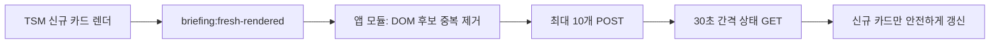

# 신규 기사 구독 요약 UI 구현 계획

기준일: 2026-11-25 · 기준 커밋: ad8975625c9fe82591602a29afb3b35a63d1671b

목표: 기존 발행 기사를 보존하고 새 소식 카드 최대 10개의 요약 요청과 상태를 표시한다.
승인: coordinator가 앱 모듈·모의 API/DOM 테스트 계획을 승인했으며, 템플릿과 생성 HTML은 TSM이 담당한다.

- [x] 계약 경계 테스트를 먼저 작성하고 미구현 실패를 확인한다.
- [x] 독립 ES module을 구현한다: 요청 중복 방지, 10개 제한, 구 API 호환, 숨김 탭 중단, 종결 상태 중단, 시각·예산 검증, textContent 렌더.
- [x] 같은 DOM 계약의 모의 화면을 Orca 브라우저로 확인한다.
- [ ] 전체 Node 테스트를 실행하고 확정 API와 다시 대조하여 PR을 준비한다.

DOM 계약: `.fresh .item[data-candidate-id]`, 선택 속성 `data-summary-status`; 국내·해외 렌더 완료 후 document 이벤트 `briefing:fresh-rendered`, detail `{updated: d.updated}`; ``.
모듈은 리스너를 먼저 등록한 뒤 기존 DOM을 검사하므로 등록 순서가 뒤바뀌어도 동작한다.

제약: parent 저장소 편집·실운영 요약 요청·유료 호출·배포 금지; 예산 90분, 확정 계약 보완 최대 2회.

확정 API v1: summary는 `{title_ko,background,key:string[],detail,implication,has_body:boolean}`이며 GET 상태 조회도 최대 10개씩 분할한다.
중복 링크는 유효한 달력 날짜를 포함하는 `/briefing/YYYY-MM-DD#kr|global|notice:부문:기사` 내부 경로만 허용하며 `cache:`·`fresh:` 식별자는 문구로만 표시한다.
검증: 신규 37개 및 전체 71개 Node 테스트 성공, 문법 검사 성공; 로컬 실제 화면에서 대기→완료·정적 보존·390px 화면 확인.
기존 실패: `node scripts/site-tools.mjs validate`는 수정하지 않은 루트 `index.html`의 theme-color·noscript 누락 2건을 보고한다.

미배포 호환: 404·405·501, HTML fallback, 미지원 status는 페이지 재열기 전까지 조용히 비활성화한다. 이후 POST·polling·오인 대기 표시를 제거하고 원문 목록과 이미 완료한 요약은 보존한다. 로컬 화면에서 404 뒤 10회 재클릭에도 최초 요청 1회·추가 요청 0회·요약 블록 0개를 확인했다.

독립 검토 보완: GET 연속 실패는 30→60→120→240→300초 백오프(최대 5분), 정상 복구 시 오류 안내 초기화; 긴 Retry-After deadline은 보존하며 최대 1시간 타이머 chunk로 대기; 과거 HTTP-date·0초는 최소 30초 재요청 억제; 미수락 POST429는 재요청 안내만 표시; ISO 소수초 1~9자리와 엄격한 달력 검증; GET의 생략 선택 필드 next_retry_at·duplicate_of·summary 초기화. failed/over_budget 초기 GET 1회는 최신 예산·결과 확인에 필요하므로 유지하며 종결 후 polling 0회. limit30은 승인 정책으로 유지.

승인된 v1.1: data-summary-requested 문자열 false는 신규 POST, true는 기존 결과 조회, 누락은 v0 유지, 잘못된 값은 해당 카드만 제외한다. 이벤트 detail.summary_available이 boolean false일 때만 document 단위 latch로 비활성화하며 이후 true나 destroy/재초기화도 같은 페이지에서는 재개하지 않는다(새 페이지 필요). 진행 중 응답도 비활성화 이후 추가 GET을 만들지 않는다. 전체 예산30과 요청429를 구분한다. 실제 SCRIPT 통합 fixture는 운영 49aa0e9fcf250f7a2d8aaa62442de40d4d23b857를 AST 상수 추출로 그대로 삽입한 기준 재현본: 신규4카드·POST0·상태GET1·requested속성없음4개, 정적본문 및 정적재시도상태 공존 확인; 운영 수정 SHA로 재생성하기 전 통합 성공으로 판정하지 않는다. 생성 명령: py -3.14 scripts/build-briefing-integration-fixture.py --publisher <운영 파일의 조회 사본> --commit <고정 40자리 SHA>. v1.2 unknown 정책은 미확정으로 코드 변경하지 않았다.
